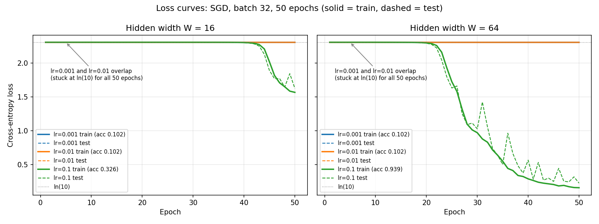

# Lab 2: A neural network from scratch (Ch. 3)

Everything is implemented in NumPy (no autograd) in [`src/lab2.py`](src/lab2.py).
Run `python lab02/src/lab2.py` from the repo root; it reproduces every number below and writes
`results/loss_curves.png`, `results/log.txt` (full console output, including per-epoch logging)
and `results/results.json`. Timings depend on the machine and vary a little from run to run.

---

## 1. Dataset [10]

- `sklearn.datasets.load_digits`: 1797 images, 8×8 → 64 features, 10 classes.
- Inputs divided by 16 → range [0, 1].
- Labels one-hot encoded, shape `(N, 10)`.
- `train_test_split(test_size=0.3, stratify=y, random_state=42)` →
  **train (1257, 64), test (540, 64)**. Class counts are balanced in both splits (122–128 train, 52–55 test).

## 2. Network design [15]

```
x (B,64) ─► Linear W1,b1 ─► z1 (B,W) ─► ReLU ─► a1 (B,W)
         ─► Linear W2,b2 ─► z2 (B,W) ─► ReLU ─► a2 (B,W)
         ─► Linear W3,b3 ─► z3 (B,10) ─► softmax ─► p (B,10)
```

| Parameter | Shape | W = 16 | W = 64 |
|---|---|---|---|
| W1 | (64, W) | 1024 | 4096 |
| b1 | (W,) | 16 | 64 |
| W2 | (W, W) | 256 | 4096 |
| b2 | (W,) | 16 | 64 |
| W3 | (W, 10) | 160 | 640 |
| b3 | (10,) | 10 | 10 |
| **Total** | | **1482** | **8970** |

Weights are initialised from N(0, 0.01) (std = 0.01), biases are zeros, seed 42.
Each matrix product `(B, n_in) @ (n_in, n_out)` gives `(B, n_out)`, so the shapes chain correctly.

## 3. Forward pass [20]

`z1 = X W1 + b1`, `a1 = ReLU(z1)`, `z2 = a1 W2 + b2`, `a2 = ReLU(z2)`, `z3 = a2 W3 + b3`,
`p = softmax(z3)`. Softmax subtracts the row maximum before `exp` for numerical stability.

| | output shape | max \|row sum − 1\| | |
|---|---|---|---|
| W = 16 | (32, 10) | 2.2e-16 | PASS |
| W = 64 | (32, 10) | 3.3e-16 | PASS |

## 4. Cross-entropy loss [10]

`L = −(1/B) Σᵢ Σₖ yᵢₖ log pᵢₖ` (probabilities are clipped at 1e-12 inside the log).

Untrained network on the full training set: **W=16: 2.3026, W=64: 2.3026**, compared with ln(10) = 2.3026
(difference 4e-7 and 7e-6). With tiny weights the logits are all ≈ 0, so softmax is uniform
(pᵢₖ ≈ 0.1) and L ≈ −log 0.1 = ln 10.

## 5. Backpropagation and gradient check [30]

### Derivation (chain rule)

**Output layer.** For softmax followed by cross-entropy, with B samples:

∂L/∂z3ᵢⱼ = (1/B) Σₖ (−yᵢₖ / pᵢₖ) · pᵢₖ(δₖⱼ − pᵢⱼ) = (1/B)(pᵢⱼ Σₖ yᵢₖ − yᵢⱼ) = (pᵢⱼ − yᵢⱼ)/B

because Σₖ yᵢₖ = 1. So **dz3 = (p − Y) / B**.

**Linear layer** `z = a W + b`. Each weight W_mn affects z_·n through a_·m, so

- dW = aᵀ dz  (shape `(n_in, n_out)`)
- db = Σ over rows of dz  (shape `(n_out,)`)
- da = dz Wᵀ  (shape `(B, n_in)`)

**ReLU** `a = max(0, z)`: **dz = da ⊙ 1[z > 0]**.

Applied from the output back to the input:

```
dz3 = (p − Y)/B
dW3 = a2ᵀ dz3        db3 = Σ dz3        da2 = dz3 W3ᵀ
dz2 = da2 ⊙ 1[z2>0]
dW2 = a1ᵀ dz2        db2 = Σ dz2        da1 = dz2 W2ᵀ
dz1 = da1 ⊙ 1[z1>0]
dW1 = Xᵀ dz1         db1 = Σ dz1        (dX is not needed)
```

### Numerical check

Ten random weights from W1, W2 and W3 are each nudged by ±1e-5. The numerical slope
`(L(w+ε) − L(w−ε)) / 2ε` is compared with the backprop value using
`rel_err = |a − n| / (|a| + |n|)`, on a batch of 32. Weights with an exactly zero gradient
(dead ReLU units, or W1 rows for border pixels that are always 0) are redrawn: 30–40% of
weights fall in this group, and a 0 = 0 comparison tests nothing.

**Result: PASS.** The check runs on the networks trained with lr=0.1, where gradients are around 1e-3:

| | weights with rel. error < 1e-6 | worst error |
|---|---|---|
| W = 16 | **10 / 10** | 3.2e-8 |
| W = 64 | **9 / 10** | 2.4e-6 (that weight's gradient is only 5e-8) |

Typical errors are 1e-9 to 1e-11. The full per-weight tables are in `results/log.txt`.

**Why the check is not run at initialisation.** Running the same check on the N(0, 0.01)
network gives 8/10 for both widths. The two misses are the weights with the smallest
gradients (≤ 7e-6). In float64 the loss ≈ 2.3 is stored only to ulp ≈ 4.4e-16, so a
central difference has an absolute floor of about 4.4e-16 / 2e-5 ≈ 2e-11. A gradient of
5e-7 therefore cannot be measured to better than ~4e-5 relative, no matter how correct
backprop is. Every weight with |grad| > 1e-5 agrees to < 1e-6. A separate check over 200
weights per network, plus every bias b1–b3, agreed in the same way: the bias differences
were ~1e-11. The only other source of disagreement is a ReLU kink, when some zᵢ lies
within ε of 0.

## 6. Training [20]

Shuffle every epoch, mini-batches of 32, plain SGD (`θ ← θ − lr·∇θ`), 50 epochs, train and test
loss logged every epoch. The same seed is used for every run.



| W | lr | final train loss | final test loss | **test accuracy** |
|---|---|---|---|---|
| 16 | 0.001 | 2.3026 | 2.3026 | 0.1019 |
| 16 | 0.01 | 2.3026 | 2.3025 | 0.1019 |
| 16 | 0.1 | 1.5656 | 1.6237 | 0.3259 |
| 64 | 0.001 | 2.3025 | 2.3025 | 0.1019 |
| 64 | 0.01 | 2.3025 | 2.3023 | 0.1019 |
| 64 | 0.1 | 0.1594 | 0.2271 | **0.9389** |

**Observations**

- **lr = 0.001 and 0.01 never leave the ln(10) plateau** (accuracy 0.102 means predicting one class).
  This comes from the required N(0, 0.01) initialisation, not from a bug. Each layer scales the
  signal by roughly 0.01·√fan_in < 1, so activations and gradients shrink through the three
  layers: W1 gradients at initialisation are ~1e-6 to 1e-5. With such tiny gradients a small
  learning rate barely moves the weights in 50 epochs. As a control, the same code with He
  initialisation (std √(2/fan_in)) reaches 94% test accuracy at lr = 0.01. That run is not
  part of the lab script.
- **lr = 0.1** is large enough to escape. The loss sits on the plateau for ~20 epochs (W=64) or
  ~40 epochs (W=16) and then drops quickly.
- **Width matters.** W = 64 escapes the plateau much earlier and reaches 93.9%. W = 16 is still
  mid-descent at epoch 50 (32.6%). A wider layer sums more terms, so each layer shrinks the
  signal less, and the gradients are larger.
- The test loss is noisier than the train loss at lr = 0.1, because one large SGD step changes
  the whole network. Train and test losses stay close, so there is little overfitting after 50 epochs.

## 7. Forward vs backward timing [10]

Median of 100 runs (after 10 warm-up runs), `time.perf_counter`, with the repo's pinned
NumPy 1.26.4 (OpenBLAS) on an Apple Silicon laptop. "Forward" is `forward()`. "Backward"
is `backward()` alone and includes no forward work. The *matmul* columns time only the
matrix products of each pass. MACs = multiply-adds in those products. W = 256 and 1024 are
extra rows added to show the trend. The numbers come from `results/log.txt`.

| W | batch | forward µs | backward µs | bwd/fwd | fwd matmul µs | bwd matmul µs | MAC ratio bwd/fwd |
|---|---|---|---|---|---|---|---|
| 16 | 32 | 17.0 | 18.2 | 1.07 | 5.4 | 8.3 | 1.29 |
| 16 | 1257 | 319.8 | 409.4 | 1.28 | 212.6 | 299.3 | 1.29 |
| **64** | **32** | **35.9** | **43.9** | **1.22** | 18.5 | 29.3 | 1.54 |
| **64** | **1257** | **717.6** | **966.9** | **1.35** | 462.9 | 697.4 | 1.54 |
| 256 | 32 | 229.0 | 337.1 | 1.47 | 127.8 | 200.2 | 1.81 |
| 256 | 1257 | 4211.0 | 6615.4 | 1.57 | 2946.7 | 5111.9 | 1.81 |
| 1024 | 32 | 1250.5 | 2904.1 | 2.32 | 1070.7 | 3157.1 | 1.94 |
| 1024 | 1257 | 34809.1 | 59447.1 | 1.71 | 27807.5 | 53424.5 | 1.94 |

**Which dominates: the backward pass, in every configuration.** At the lab widths it is
7–35% slower than the forward pass, and at W = 1024 it is 1.7–2.3× slower. Repeated runs
at batch 1257 vary by roughly ±20%, because OpenBLAS spreads these products over several
threads. Backward was the slower pass in every repeat.

**Link to matrix multiplication.** The forward pass does one matmul per layer
(3 in total: `X W1`, `a1 W2`, `a2 W3`). The backward pass needs two per layer: one for the
weight gradient (`aᵀ dz`) and one to send the error back to the previous layer (`dz Wᵀ`).
Only the first layer skips its `dz Wᵀ`, because nobody needs dX. That gives 5 matmuls, of the
same sizes as the forward ones:

- forward MACs = B(64W + W² + 10W)
- backward MACs = B(64W + W² + 10W) + B(10W + W²)

The ratio rises from 1.29 (W=16) to 1.54 (W=64) and approaches 2 as the W² terms take over.

The share of each pass spent in matrix products grows with size: 32–46% at W = 16 and
batch 32, 65–73% at W = 64 and batch 1257, and 80–90% at W = 1024 and batch 1257. The measured bwd/fwd ratio follows the MAC
ratio, and gets closer to it as matmuls take over (W=1024, batch 1257: 1.71 measured vs 1.94
predicted). The rest of each pass is element-wise work: softmax `exp`, ReLU and its mask,
bias adds, and Python/NumPy call overhead. That work is about the same size in both passes,
so it pulls the ratio towards 1 for small networks. At batch 32 and W = 16 each pass takes
only ~17 µs, most of it fixed per-call overhead. Products with a transposed operand
(`aᵀ dz`, `dz Wᵀ`) are also less cache-friendly, which is why the backward matmul time can
exceed the MAC ratio (W=1024, batch 32).

So the "backward costs about twice the forward" rule comes from matrix multiplication.
It holds best when matmul FLOPs are the bottleneck, as in real networks, which is why
training (forward + backward) costs roughly 3× inference.

---

## Graded evidence

- **Gradient check:** PASS, 10/10 (W=16) and 9/10 (W=64) below 1e-6. See §5 and `results/log.txt`.
- **Loss curves:** `results/loss_curves.png`
- **Timing breakdown:** §7 table, `results/log.txt` and `results/results.json`
