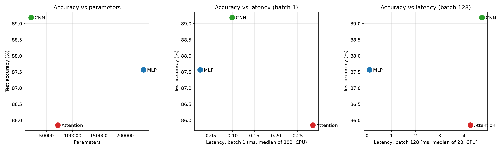

# Lab 3: Architectures and their costs

Everything is in [`src/lab3.py`](src/lab3.py). Run `python lab03/src/lab3.py` from the repo root; it reproduces every number below and writes
`results/tradeoffs.png`, `results/results.json` and `results/log.txt` (full console output, including the torchinfo summaries and per-epoch logging). Timings depend on the machine and vary a little from run to run.

Setup: PyTorch 2.14, Apple Silicon Mac. Training ran on MPS; all latency measurements ran on the CPU (4 threads) for repeatability. Seed 0.

## 1. Dataset

`torchvision.datasets.FashionMNIST` with `ToTensor()` + `Normalize((0.2860,), (0.3530,))`.
The official 60k train set is split 55,000 / 5,000 (train / validation) with `random_split` (seed 0). The official 10k test set is used for the final accuracy. Batch size is 128.

## 2. Models

| Model | Architecture | Params (torchinfo) |
|---|---|---:|
| MLP | Flatten 784 → Linear 256 → ReLU → Linear 128 → ReLU → Linear 10 | 235,146 |
| CNN | Conv(1,16,3,p1) → ReLU → MaxPool2 → Conv(16,32,3,p1) → ReLU → MaxPool2 → Linear(1568,10) | 20,490 |
| Attention | 16 patches of 7×7 → Linear 49→64 (+ learned pos. emb.) → 2× TransformerEncoderLayer(d=64, h=4, ff=128) → mean pool → Linear 64→10 | 71,818 |

I implemented the architectures exactly as specified. None of them lands in the 100k–150k target band: the MLP is larger (the first layer alone has 200,960 weights), while the CNN and the Attention model are smaller. I kept the specified layer sizes so the FLOP formulas map one-to-one onto the code. The parameter imbalance is part of the comparison below. The Attention model uses a learned positional embedding (16×64 = 1,024 params). Without it, mean pooling would make the model invariant to patch order.

## 3. Compute cost

### 3.1 Hand-calculated FLOPs (batch 1, FLOPs = 2 × MACs)

The calculations were first done by hand on paper (21.10.2026). Photos: [page 1: formulas, per-layer params and FLOPs](hand_calculations/1_flops_and_params.jpg), [page 2: summary](hand_calculations/2_summary.jpg). The tables below are typed up from those pages.

**MLP (Linear: 2 × in × out)**

| Layer | Formula | FLOPs |
|---|---|---:|
| Linear 784→256 | 2·784·256 | 401,408 |
| Linear 256→128 | 2·256·128 | 65,536 |
| Linear 128→10 | 2·128·10 | 2,560 |
| **Total** | | **469,504** |

**CNN (Conv2d: 2 × K² × C_in × C_out × H_out × W_out)**

| Layer | Formula | FLOPs |
|---|---|---:|
| Conv1 | 2·3·3·1·16·28·28 | 225,792 |
| Conv2 | 2·3·3·16·32·14·14 | 1,806,336 |
| Linear 1568→10 | 2·1568·10 | 31,360 |
| **Total** | | **2,063,488** |

**Attention (seq = 16, d_model = 64, ff = 128), one encoder layer**

| Component | Formula | FLOPs |
|---|---|---:|
| QKV projections | 2·seq·d·3d = 2·16·64·192 | 393,216 |
| Scores QKᵀ | 2·seq²·d = 2·256·64 | 32,768 |
| Scores × V | 2·seq²·d | 32,768 |
| Output projection | 2·seq·d·d | 131,072 |
| FFN (two Linears) | 2·seq·d·ff·2 | 524,288 |
| **One encoder layer** | | **1,114,112** |

Whole Attention model: patch projection 2·16·49·64 = 100,352, plus 2 × 1,114,112 for the encoder layers, plus the head 2·64·10 = 1,280. The total is **2,329,856** FLOPs.

Biases, ReLU, MaxPool, softmax and LayerNorm are left out of the hand count, as in the Ch. 4 formulas.

### 3.2 Hand count vs `thop.profile`

thop reports MACs, so I doubled them to get FLOPs.

| Model | Hand FLOPs | thop MACs | thop × 2 | Gap |
|---|---:|---:|---:|---|
| MLP | 469,504 | 234,752 | 469,504 | exact match |
| CNN | 2,063,488 | 1,031,744 | 2,063,488 | exact match |
| Attention | 2,329,856 | 591,488 | 1,182,976 | thop is **49% lower** |

The gaps have three explanations:

* **Units.** thop (and torchinfo's "mult-adds") count multiply-accumulates. The Ch. 4 formulas count a multiply and an add as 2 FLOPs, so there is a factor of 2 everywhere. Once that factor is applied, the MLP and the CNN match exactly. thop ignores biases and counts 0 for ReLU and MaxPool, which matches the hand count.
* **Missing attention.** thop's per-layer breakdown shows `self_attn: 0` in both encoder layers. thop has no counting rule for `nn.MultiheadAttention`. The Q/K/V projection is a raw `in_proj_weight` parameter used inside `F.multi_head_attention_forward`, not an `nn.Linear` module. `out_proj` is a `NonDynamicallyQuantizableLinear`, and thop matches module types exactly, so it does not recognise that subclass as `nn.Linear`. As a result, thop misses the QKV projections, both seq² matmuls and the output projection: 589,824 FLOPs per layer, or 1,179,648 for both layers.
* **Extra LayerNorm.** In the other direction, thop counts LayerNorm (4 × 4,096 MACs = 32,768 FLOPs), which I did not count by hand.

Check: 2,329,856 − 1,179,648 + 32,768 = 1,182,976, which equals thop × 2 exactly.

torchinfo is wrong in a different way for the Attention model. It reports only 0.04 M mult-adds, because it counts only the patch projection and the head through its own layer hooks. Profiling tools rely on per-module hooks, so they silently under-count fused or functional operators, and attention is the main victim.

### 3.3 Inference latency (CPU, 4 threads, `torch.inference_mode`, 10 warm-up runs)

| Model | Batch 1, median of 100 runs | Batch 128, median of 20 runs | Per image at batch 128 |
|---|---:|---:|---:|
| MLP | 0.025 ms | 0.098 ms | 0.8 µs |
| CNN | 0.099 ms | 4.744 ms | 37.1 µs |
| Attention | 0.285 ms | 4.262 ms | 33.3 µs |

## 4. Training (5 epochs, Adam, lr 1e-3, batch 128)

| Model | Val acc (epoch 5) | **Test accuracy** |
|---|---:|---:|
| MLP | 88.80% | **87.57%** |
| CNN | 89.72% | **89.19%** |
| Attention | 86.64% | **85.85%** |

Per-epoch loss and validation accuracy are stored in `results/results.json`.

## 5. Trade-offs

**Accuracy vs parameters.** The CNN is the most accurate model (89.2%) with 11× fewer parameters than the MLP (20k vs 235k). The Attention model has 3.5× more parameters than the CNN and is still the least accurate. Accuracy per parameter strongly favours the CNN.

**Accuracy vs latency.** The MLP is the fastest by a wide margin: about 4× faster than the CNN at batch 1 and about 48× faster at batch 128. Yet it does about 4× fewer FLOPs than the CNN, so FLOPs alone do not predict latency. Memory access patterns explain the rest (Ch. 4.6–4.7):

* **MLP: dense matrix multiplication.** Every weight is read once and used once per sample. At batch 1 this is a memory-bound GEMV: 0.94 MB of weights for 0.47 MFLOP, about 0.5 FLOP/byte. Batching turns it into a GEMM in which each weight load is reused 128 times. The access is perfectly sequential and maps directly onto BLAS, so latency grows only 3.9× from batch 1 to batch 128 while the work grows 128×. Its weakness is the large parameter footprint and the lack of spatial inductive bias, which costs accuracy.
* **CNN: sliding-window convolution.** Its weights are tiny (82 KB) and reused at every spatial position, which gives high arithmetic intensity: about 25 FLOP/byte of weights. The cost moves to activations, though. Conv1 produces 16×28×28 feature maps, and the data must be gathered into overlapping windows (im2col or a direct convolution). With only 1–32 channels, the CPU's vector units are poorly used, so the CNN does not reach BLAS efficiency. At batch 128 it runs at about 56 GFLOP/s against the MLP's about 600 GFLOP/s, so it is about 11× slower per FLOP, even though the reuse makes it the best model per byte stored.
* **Attention: dynamic, data-dependent mixing.** QKV and FFN are dense GEMMs, with weights reused over 16 tokens. On top of that come the seq² score matrix, softmax, and head split/merge (reshape and transpose). The dependency between steps (scores → softmax → weighted sum) and the many small kernels make this workload dominated by overhead and memory traffic at d_model = 64, seq = 16. At batch 1 it has the highest latency, about 3× the CNN. At batch 128 those fixed overheads are amortised and the dense GEMMs dominate: it reaches about 70 GFLOP/s and is slightly faster than the CNN (4.3 vs 4.7 ms). It still has the highest FLOP count and the lowest accuracy after 5 epochs. Transformers lack the locality prior of the CNN and usually need more data and epochs to catch up.

**Most cost-effective model.** The **CNN** is the most cost-effective overall. It has the best accuracy, the smallest model (memory and storage are the scarcest resource on edge hardware) and the best accuracy per parameter. Its latency (about 0.1 ms per image at batch 1) is acceptable for almost any deployment. The **MLP** wins when throughput or latency on a CPU is the only metric, because its dense, sequential, BLAS-friendly access pattern is the cheapest for the hardware to execute. That speed costs 1.6 points of accuracy and 11× the parameters. At this scale the **Attention** model is the least cost-effective. It is 3.3 points less accurate than the CNN with 3.5× the parameters, and 3× slower at batch 1. Its only edge is a roughly 10% advantage at batch 128, which is within the range where run-to-run timing noise matters. Its O(seq²) dynamic access pattern only pays off when long-range interactions matter and there is enough data and training time.

