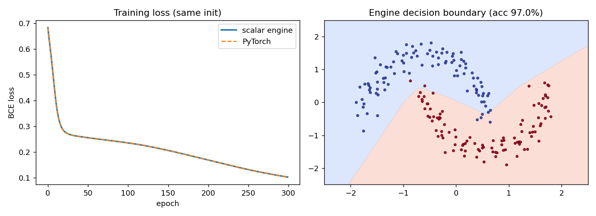

# Lab 5: Frameworks and automatic differentiation

The autograd engine is in [`src/engine.py`](src/engine.py), all experiments are in [`src/lab5.py`](src/lab5.py). Run `python lab05/src/lab5.py` from the repo root; it reproduces every number below and writes `results/results.json`, `results/log.txt` (full console output) and `results/moons_training.png`. The whole run takes about 3 minutes, almost all of it in the scalar engine. Timings depend on the machine and vary a little from run to run.

Setup: Python 3.11, PyTorch 2.3.1, Apple M1, CPU only. Seed 0.

## 1. The `Value` node

Each `Value` stores:

| Field | Meaning |
|---|---|
| `data` | scalar result of the forward pass |
| `grad` | ∂output/∂this node, filled in by `backward()` |
| `_prev` | parent nodes the value was computed from |
| `_op` | name of the operation (`+`, `*`, `**2`, `relu`, …), used to print the graph |
| `_backward` | closure with the local derivative rule: it pushes `out.grad` into the parents' `grad` |

`__slots__` keeps the node small, since the training graph has about 28k nodes per epoch.

## 2. Operations and graph construction

The core operations are `+`, `*`, `**k` (constant exponent) and `relu`. Each one computes the result, creates a new `Value` whose `_prev` are the inputs, and attaches its local rule:

| Op | Forward | Local rule |
|---|---|---|
| `a + b` | a + b | ∂/∂a = 1, ∂/∂b = 1 |
| `a * b` | a·b | ∂/∂a = b, ∂/∂b = a |
| `a ** k` | aᵏ | ∂/∂a = k·aᵏ⁻¹ |
| `a.relu()` | max(a, 0) | ∂/∂a = 1 if a > 0 else 0 (same subgradient at 0 as PyTorch) |

Subtraction, negation and division are built from these (`a - b = a + (-1)·b`, `a / b = a · b⁻¹`), so they need no rules of their own. For the classifier in part 5 I added `sigmoid` and `log`.

So the graph is built as a side effect of ordinary Python arithmetic, the same "define-by-run" (eager) approach PyTorch uses. For `((a*b + c)**2).relu()` with a = 2, b = −3, c = 10 the engine records:

```
     c  data=10     parents=[]
     b  data=-3     parents=[]
     a  data=2      parents=[]
     *  data=-6     parents=[2, -3]
     +  data=4      parents=[-6, 10]
   **2  data=16     parents=[4]
  relu  data=16     parents=[16]
out = 16;  da = -24, db = 16, dc = 8
```

## 3. Backward pass

`backward()`:

1. **Topological sort.** `topo_order()` does a DFS and appends a node only after all of its parents, so every node comes after its inputs. The DFS is iterative, because the per-epoch training graph is thousands of nodes deep (a chain of `vsum` additions) and a recursive version would hit Python's recursion limit.
2. **Seed.** The output gets `grad = 1`.
3. **Reverse order.** The nodes are visited from the output back to the leaves, and each node's `_backward` is called. Reverse topological order guarantees that a node's `grad` is complete (all its consumers have already contributed) before it is pushed further back.
4. **Accumulation.** Every rule uses `+=`, never `=`. A node used in several places gets the sum of the contributions from every path, which is the multivariable chain rule. Check: for `y = x*x + x` at x = 3 the engine gives dy/dx = 7 = 2x + 1. With `=` instead of `+=` it would give 1 (the last write wins).

As in PyTorch, leaf gradients also accumulate across `backward()` calls, so the training loop zeroes them before every step.

## 4. Gradient check

Function: `((a*b + c)**2).relu().sum()` with a, b, c random vectors of 10 elements (`sum` is a chain of `+` nodes in the engine). PyTorch runs in float64 so the comparison is not limited by float32 rounding. The numerical gradient uses central differences with h = 1e-6.

| Comparison (30 gradients) | Max absolute difference |
|---|---:|
| engine vs PyTorch autograd | **0.0** |
| engine vs numerical | 1.0e-09 |
| PyTorch vs numerical | 1.0e-09 |

Both are below the 1e-6 threshold. The engine matches PyTorch bit for bit: both compute the same float64 operations in the same order. The 1e-9 against the numerical estimate is the error of finite differences (rounding of order ε/h), not of the engine.

## 5. Training on `make_moons`

Data: `make_moons(n_samples=200, noise=0.1, random_state=0)`, standardised. Model: Linear 2→8 → ReLU → Linear 8→1 → sigmoid, BCE loss, full-batch SGD, lr 0.5, 300 epochs. Both implementations start from the same weights (PyTorch's default `nn.Linear` init, copied into the engine) and PyTorch runs in float64 with 1 thread, so the two runs should be the same computation.

| | Scalar engine | PyTorch |
|---|---:|---:|
| Training time, median of 5 runs | **32.9 s** | **0.036 s** |
| Final BCE loss | 0.102466 | 0.102466 |
| Max \|loss difference\| over all 300 epochs | 2.0e-12 | |
| Train accuracy | 97.0% | 97.0% |



The loss curves are identical (largest difference 2e-12, summation-order rounding), which shows end to end that the engine's gradients are right. PyTorch is about **900× faster**. The engine builds a graph of 28,403 Python objects every epoch: one node per scalar multiply, add, ReLU etc. Each node costs an object allocation, a closure and a Python function call in forward and in backward, i.e. hundreds of nanoseconds of interpreter overhead for one floating-point operation. PyTorch represents the same epoch with about 10 tensor operations (`addmm`, `relu`, `sigmoid`, `binary_cross_entropy` and their backward kernels). Each one is a single call into compiled C++ code that loops over all 200 samples, so the Python overhead is paid per tensor operation and not per scalar. This is the main argument of Ch. 7 for tensors as the basic abstraction of a framework: they amortise the dispatch cost over many elements.

The first PyTorch run in a process is much slower (7 s in a first test without warm-up), because of lazy initialisation (library loading, optimiser setup, allocator). The script therefore does one untimed warm-up run; the median of 5 would hide it anyway.

## 6. PyTorch internals

Model: `SmallMLP` = Linear 64→256 → ReLU → Linear 256→256 → ReLU → Linear 256→10 (85k parameters), CPU, 4 threads.

### 6.1 Graph inspection

**Dynamic autograd graph.** Walking `model(x).sum().grad_fn` through `next_functions` shows the backward graph PyTorch recorded during the forward pass:

```
SumBackward0
  AddmmBackward0
    AccumulateGrad  -> leaf (10,)
    ReluBackward0
      AddmmBackward0
        AccumulateGrad  -> leaf (256,)
        ReluBackward0
          AddmmBackward0
            AccumulateGrad  -> leaf (256,)
            TBackward0
              AccumulateGrad  -> leaf (256, 64)
        TBackward0
          AccumulateGrad  -> leaf (256, 256)
    TBackward0
      AccumulateGrad  -> leaf (10, 256)
```

This is the tensor-level version of my engine: `AddmmBackward0` is the local rule of a fused `bias + x @ Wᵀ`, `TBackward0` is the transpose of the weight, and `AccumulateGrad` writes into the leaf's `.grad` with `+=`, exactly like the engine's leaves.

**Static graph.** `torch.fx.symbolic_trace` captures the forward pass as an explicit graph before running it: `placeholder x → fc1 → relu → fc2 → relu_1 → fc3 → output`. This is the representation compilers work on.

### 6.2 Eager vs compiled vs traced

Inference, `torch.inference_mode`, median of 50 runs after 10 warm-up runs. The outputs of all three variants match eager within 1e-5.

| Batch | Eager | `torch.jit.trace` | `torch.compile` (inductor) |
|---:|---:|---:|---:|
| 1 | 22.9 µs | 17.3 µs | 25.8 µs |
| 32 | 32.6 µs | 26.7 µs | 38.7 µs |
| 1024 | 314.9 µs | 328.8 µs | 278.5 µs |

| Workload | Eager | `torch.compile` |
|---|---:|---:|
| Training step, batch 256 (forward + backward + SGD) | 393.5 µs | 406.2 µs |
| Pointwise chain `(x·σ(x) + 0.5·tanh x)·1.7 − 0.1·x²`, 4M floats | 17.2 ms | **9.7 ms (1.8×)** |
| One-off cost of the first `torch.compile` call | | 1–4 s |

Observations:

* For the small MLP the compiled model is **not** faster at small batches, it is 10–20% slower. The model is three `addmm` calls, and they already go to the same optimised BLAS kernels in eager mode. Inductor can only fuse the bias and ReLU into the surrounding code, which saves very little, and each call of the compiled module pays for guard checks (shape, dtype, device) and the wrapper. At batch 1 and 32, where the whole forward takes 20–40 µs, that fixed overhead is larger than the saving.
* `torch.jit.trace` is about 20% faster than eager at batch 1 and 32. It records the graph once and then runs it in the TorchScript interpreter, so the per-layer Python overhead (`nn.Module.__call__`, hooks) disappears. At batch 1024 the GEMMs dominate and all three variants are within about 15% of each other, i.e. within run-to-run noise.
* The training step shows the same picture: the work is in the GEMMs and their backward, and compiling gives nothing.
* The pointwise chain is where compilation pays off. In eager mode each of the 9 operations is a separate kernel that reads 16 MB and writes a new 16 MB intermediate. Inductor fuses the chain into one loop that reads `x` once and writes the result once, so memory traffic drops several times and the run time almost halves.
* The first call of `torch.compile` takes 1–4 s (tracing with Dynamo, code generation and C++ compilation). This has to be amortised over many calls.

### 6.3 Tensor representation and contiguity

A tensor is a pointer into a storage plus shape, stride and dtype. Views like `.t()` or slicing only change the strides and share the storage, no data is copied:

| Tensor | Shape | dtype | Stride | Contiguous | Shares storage |
|---|---|---|---|---|---|
| `big` | (4096, 4096) | float32 | (4096, 1) | yes | – |
| `big.t()` | (4096, 4096) | float32 | (1, 4096) | **no** | yes |
| `big[:, ::2]` | (4096, 2048) | float32 | (4096, 2) | **no** | yes |
| `big.t().contiguous()` | (4096, 4096) | float32 | (4096, 1) | yes | no (copy) |

Speed of the same values in a contiguous tensor vs a non-contiguous `.t()` view (4096×4096 float32, median of 20):

| Operation | Contiguous | `.t()` view | Slowdown |
|---|---:|---:|---:|
| `x + 1` | 3.92 ms | 3.89 ms | 1.0× |
| `x.exp()` | 8.72 ms | 8.81 ms | 1.0× |
| `x.sum(dim=1)` | 1.12 ms | 3.16 ms | **2.8×** |
| `x @ W` (W 4096×256) | 11.0 ms | 16.5 ms | **1.5×** |
| `x.reshape(-1)` | 0.001 ms | 23.1 ms | copy instead of view |
| one-off `.contiguous()` | | 23.2 ms | |

* Pure elementwise ops do not care: every element is independent, so PyTorch's TensorIterator simply walks the transposed tensor in its memory order and the access is still sequential.
* A reduction along `dim=1` on the `.t()` view walks memory with stride 4096 floats (16 KB). Every element comes from a different cache line, so most of each loaded line is wasted and the operation becomes 2.8× slower.
* The matmul is 1.5× slower: BLAS has to use a transposed layout or pack the operand first.
* `reshape(-1)` on a contiguous tensor is a free view. On the transposed view it must copy all 64 MB (23 ms), and `view(-1)` fails with "view size is not compatible with input tensor's size and stride". Layout bugs like this are invisible in the shape, only `stride()` / `is_contiguous()` show them.
* An explicit `.contiguous()` costs 23 ms, about two reductions' worth. It pays off only when the tensor is used several times in the non-friendly direction.

## 7. When does compilation help?

Compilation (`torch.compile`, tracing, XLA, TensorRT, …) removes per-operation overhead and lets the compiler see a whole graph instead of one op at a time. From the measurements above:

* **It helps** when the model has many small or memory-bound operations: chains of pointwise ops, normalisation and activations around them, small tensors where Python dispatch dominates, or many tiny layers. Fusion cut the pointwise chain by 1.8×, and tracing alone removed about 20% of the Python overhead of the small MLP at batch 1. It also helps when the same shapes are executed very many times (serving, long training runs), so the compile time is amortised, and when a graph is needed for deployment anyway (TorchScript, ONNX, mobile).
* **It does not help** when the run time is already dominated by big library kernels (GEMMs, convolutions) that eager mode calls directly, as in our MLP's training step; when the model is tiny and runs only a few times, so the 1–4 s compile time never pays off; and when shapes or control flow change often, which causes recompilation or graph breaks back into eager Python.
* For debugging and research eager mode stays the better default, because the code runs line by line and can be inspected. A sensible workflow is to develop eagerly, profile, and compile only the hot, stable part of the model, then measure again after warm-up: as this lab shows, the compiled version can just as well be slower.
